# Ops-Chat — 운영 인시던트 대응 AI 에이전트

운영 인시던트 진단·대응을 돕는 AI 에이전트 (LangGraph + MCP, 로컬 Ollama / OpenAI 지원).
장애 증상을 질문하면 시스템 상태·로그를 조회하고, 알맞은 대응 매뉴얼(runbook)을 찾아 진단 절차를 안내한다.

> 실습용 프로젝트다. 모니터링 데이터(`data/monitoring.json`)와 로그(`data/logs/`)는 **직접 만든 가짜 샘플**이며, 실시간 수집 시스템이 아니다.

## 주요 기능

- **질문 유형 자동 분류**: 잡담 / 장애 문의 / 모르는 시스템으로 나눠, 장애 문의만 조사 파이프라인으로 보내고 나머지는 바로 응답한다(분류 오류는 아래 [한계](#한계) 참고).
- **장애 대응 파이프라인**: 계획 수립 → 조사(상태·매뉴얼 조회, `PIPELINE=multi`에서는 로그 조회 포함) → 분석(필요할 때만) → 답변 작성 → 검수(반려 시 최대 3회 재작성) → 최종 답변.
- **일시적 조회 실패 자동 재시도**: 재시도 성공 여부까지 진행 단계에 표시한다. 시연을 위해 첫 조회가 일부러 한 번 실패하도록 넣어 둔 장치가 있다.
- **채팅 화면**: 단계별 진행 상황과 답변이 실시간(SSE)으로 나오고, LLM에 전달된 최종 프롬프트도 확인할 수 있다.

## 한눈에 보기

기존 Base 에이전트의 두 가지 문제를 고쳤다.

1. 사용자 질문은 보지 않고 알림 글자의 키워드만으로 매뉴얼을 골라, 엉뚱한 매뉴얼을 안내했다.
2. 목록에 없는 시스템을 물으면 다른 시스템의 수치로 그럴듯한 오답을 만들었고, 틀렸다는 사실이 화면에 드러나지 않았다.

| 지표 | Before | After |
|---|---|---|
| runbook 선택 정확도 (개발 질문 23개) | 57% (13/23) | **83% (19/23)** |
| runbook 선택 정확도 (검증용 질문 20개, 개발에 쓰지 않음) | 50% (10/20) | **85% (17/20)** |
| 목록에 없는 시스템 질문 | 약 38초, 다른 시스템 수치로 오답 | **약 1.8초, "조회할 수 없습니다" 안내** |
| 맞는 매뉴얼이 없는 질문 | 무조건 `db-down` 반환 | 유사도 0.5 미만이면 "매뉴얼 없음" 안내 |
| 자동 테스트 | 0개 | **41개** (약 1초) |

정확도는 답변 문장이 아니라 **어떤 runbook을 골랐는지**로 채점한다(LLM 문장은 매번 달라지기 때문). 측정 과정과 시행착오는 [doc/REPORT_LOG.md](doc/REPORT_LOG.md)에 있다.

## 구조

**Before (기존)** — 조사 노드 하나가 조회하고, 부족하면 처음으로 돌아가 다시 조사한다.

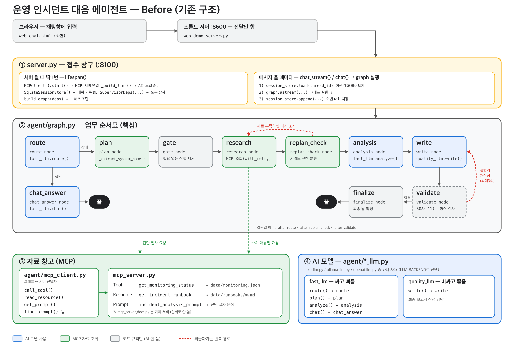

**After (개선 후)** — 조사를 총괄 서브그래프로 바꾸고, 하위 에이전트 세 개(metrics ∥ log → runbook)가 분업한다. 모르는 시스템은 조사로 들어가지 않고 곧바로 안내한다.

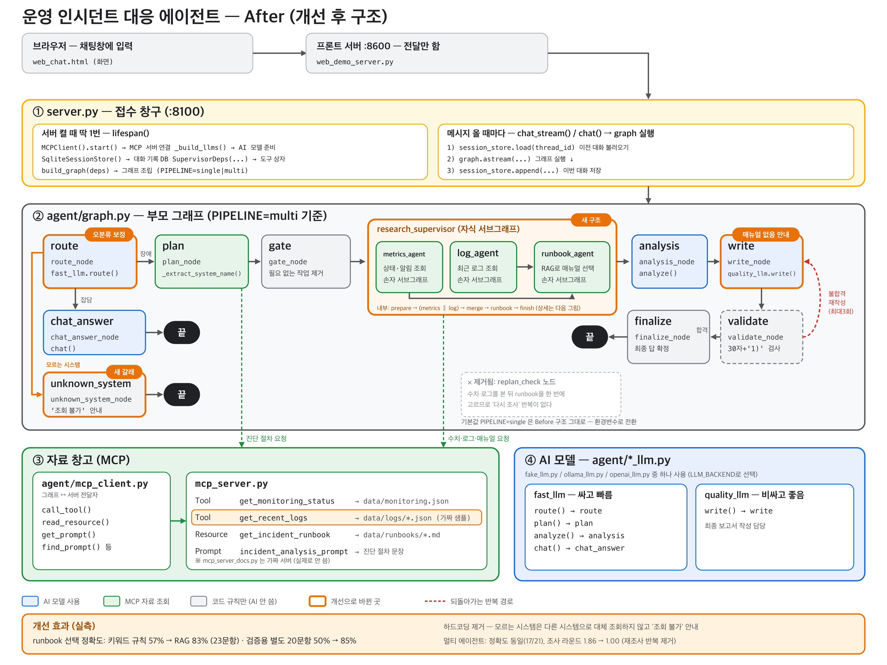

조사 총괄 내부는 [상세도](report_assets/structure_detail.png)를 참고한다.

### 핵심 개선

- **RAG** — runbook 선택을 키워드 규칙에서 bge-m3 임베딩 의미 검색으로 교체. 검색어는 질문에 아는 시스템이 있을 때만 알림을 함께 쓰는 `auto` 방식이다(질문+알림을 항상 쓰면 오히려 61%로 떨어졌다).
- **모르는 시스템 안내** — 질문에서 시스템 이름을 뽑아 목록과 대조하고, 없으면 조사와 답변 작성(LLM·MCP) 없이 바로 안내한다(질문 분류용 모델 호출 1회만 남는다).
- **멀티 에이전트** — `research_supervisor`가 `metrics_agent`, `log_agent`를 동시에 실행한 뒤 `runbook_agent`가 RAG로 매뉴얼을 고른다. 각각 LangGraph 서브그래프이며 재조사 반복(`replan_check`)이 필요 없다(평균 조사 라운드 1.86 → 1.00, 정확도는 동일). 기본값은 기존 방식이고 `PIPELINE=multi`로 전환한다.
- **MCP** — Tool `get_monitoring_status`, `get_recent_logs`, Resource `get_incident_runbook`, Prompt `incident_analysis_prompt`.
- **의존성 주입·모듈화·테스트** — 모든 노드가 `deps`로 모델/MCP/검색기를 주입받아, 테스트에서 가짜로 갈아 끼운다. 노드는 `agent/nodes/`, 에이전트는 `agent/agents/`로 분리했다.
- **LangSmith** — 노드와 에이전트를 `@traceable`로 기록한다.

## 실행 화면과 검증 결과

### 개선 전(Before) 실제 화면

> 개선 전 코드로 2026-10-20에 로컬 Ollama(qwen3)에서 캡처했다.

**① 목록에 없는 시스템을 물었는데 다른 시스템 수치로 답했다.** `billing-service`를 물었는데 계획이 `auth-service`를 조사하고, 그 수치(p95 2.4s, 커넥션 풀 92%)로 그럴듯하게 답한다.

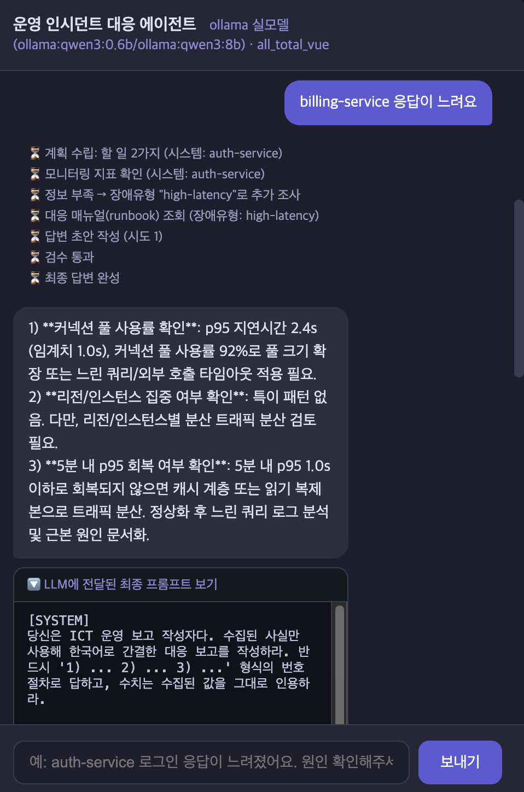

**② 키워드 규칙이 엉뚱한 매뉴얼을 골랐다.** `web-01 CPU 급증`을 물었는데 알림 글자의 키워드만 보고 `db-down` 매뉴얼을 골라 DB 점검을 안내한다.

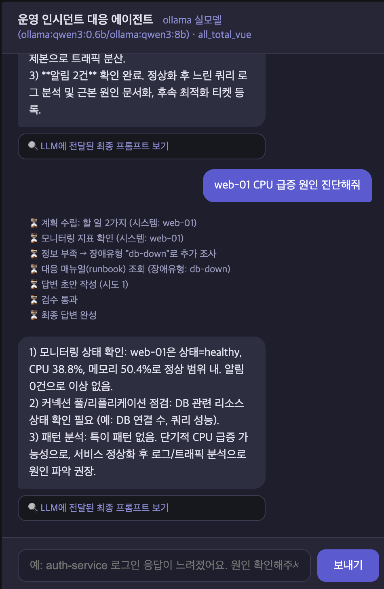

**③ 일시적 조회 실패는 자동 재시도하고, 진행 단계에 `재시도 성공`으로 표시한다**(시연을 위해 첫 조회가 일부러 한 번 실패하는 장치가 있다).

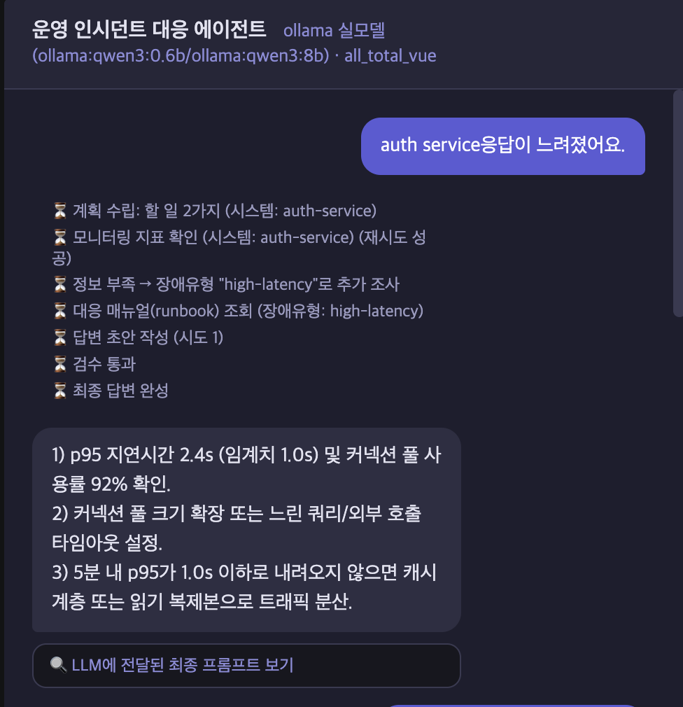

### 같은 질문의 개선 후(After) 화면

위 ①②와 **같은 질문**을 개선된 구조(`PIPELINE=multi`)에 보냈다. 한 화면에 두 질문이 이어서 나온다.

- **`billing-service 응답이 느려요`** — 조사 없이 "모니터링 대상 목록에 없어 조회할 수 없습니다"와 조회 가능한 시스템 목록을 안내한다(Before: auth-service 수치로 오답).
- **`web-01 CPU 급증 원인 진단해줘`** — 메트릭·로그·매뉴얼 에이전트를 거쳐 매뉴얼 `cpu-spike`를 골랐고(Before: `db-down`), 로그를 근거로 "CPU 35.6%로 급증 상태가 아니다"라고 답한다(웹서버 데이터가 정상으로 설정된 샘플이다).

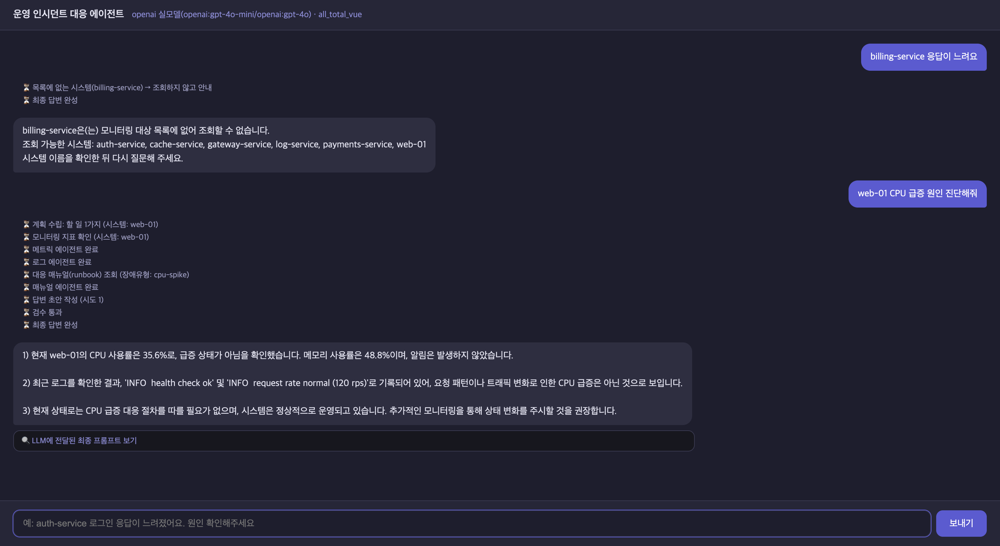

> **비교할 때 유의할 점**: Before는 로컬 Ollama(qwen3), After는 OpenAI(gpt-4o-mini / gpt-4o)로 캡처해 **모델이 다르다.** 답변 문장은 모델에 따라 달라지므로, 이 비교가 보여 주는 것은 문장 품질이 아니라 **잘못된 동작(없는 시스템에 오답, 엉뚱한 매뉴얼)이 사라졌다**는 점이다. 매뉴얼 선택 정확도는 모델과 무관한 검색(RAG)이 정하며, 아래 평가 표로 별도로 측정했다.

### 개선 후(After) 최종 실행 화면

> OpenAI 모델(gpt-4o-mini / gpt-4o)에 같은 질문(`cache-service 메모리가 계속 올라가요`)을 보내, 서버를 `PIPELINE=single` / `multi`로 각각 켜서 캡처했다. 화면의 수치(메모리 87.6%, 89.2% 등)는 호출마다 값을 흔들게 만든 시뮬레이션이라 매번 다르다.

**multi** — 메트릭·로그·매뉴얼 에이전트가 차례로 끝나고, 재조사 단계가 없다. 답변이 **로그를 근거로 인용**한다(로그는 가짜 샘플 데이터).

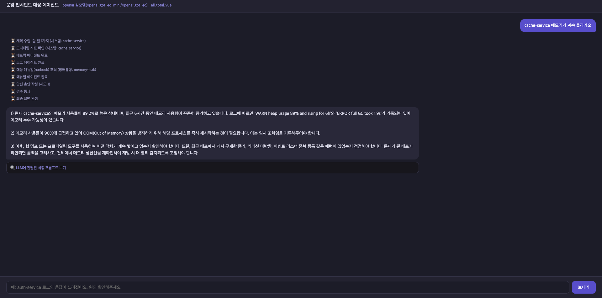

**single(기본값)** — `정보 부족 → 추가 조사`(재조사)가 한 번 일어나고, 로그는 가져오지 않는다.

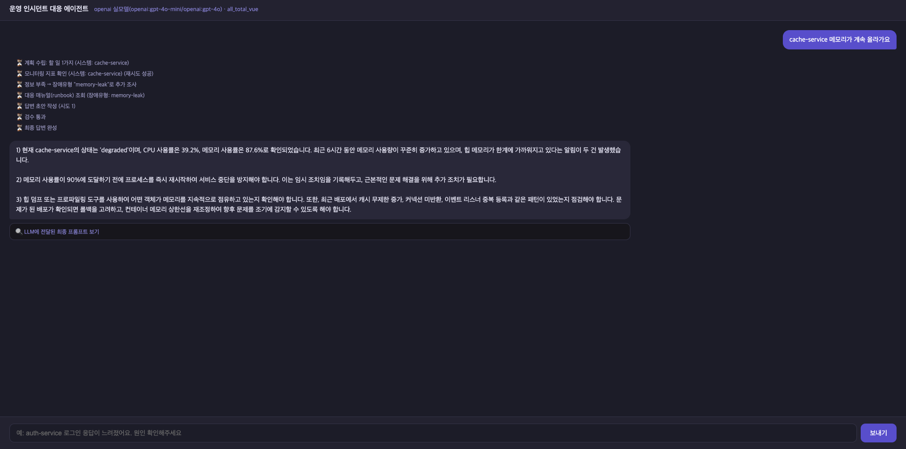

### LangSmith 트레이스

**single** 방식 한 요청의 전체 기록이다(노드 → MCP·AI 호출, 단계별 시간). `research`가 두 번 나타나는 것이 재조사 반복이다.

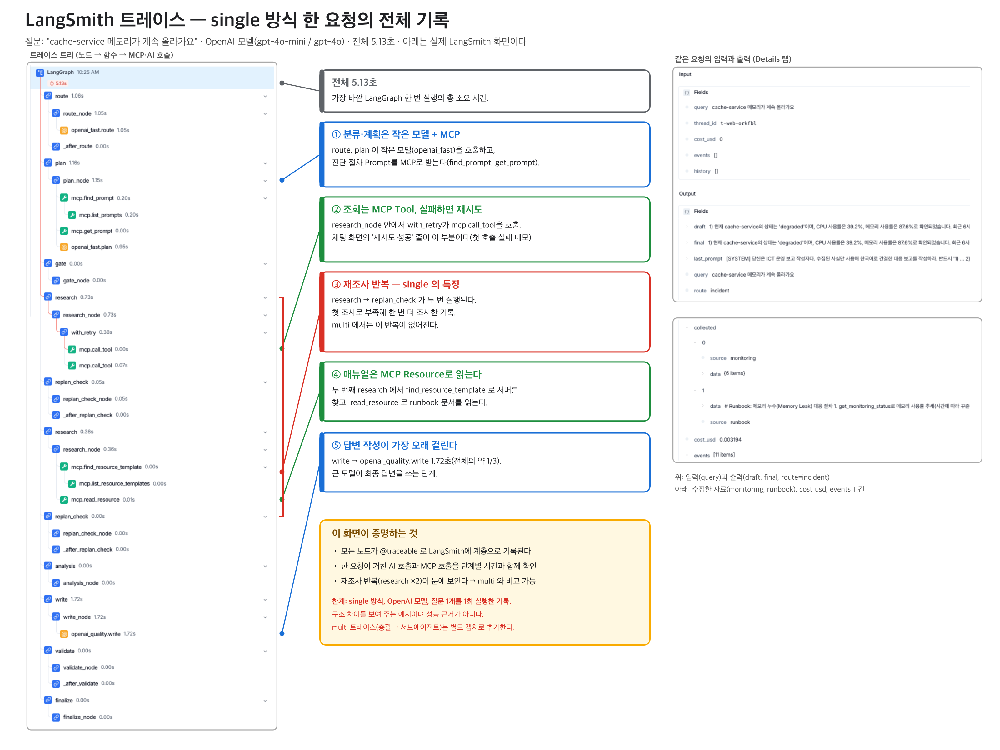

**multi** 방식 한 요청의 전체 기록이다. `research` 반복이 없고, `research_supervisor` 아래에서 `log_agent`와 `metrics_agent`(병렬)가 끝나면 `merge`로 합쳐지고, 이어서 `runbook_agent`(`select` → `read`)가 실행된다. 각 에이전트는 자기 서브그래프이며, 그 안에서 MCP 도구(`mcp.call_tool`, `mcp.read_resource`)를 호출한다. 태그 `pipeline:multi`로 구분된다.

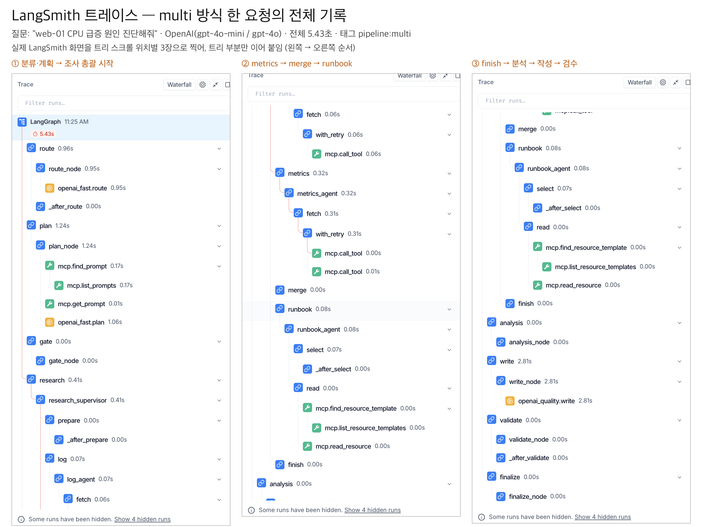

### runbook 선택 정확도 평가 (`eval/run_eval.py`, 개발 질문 23개)

방식별 정확도 — 키워드 규칙(`rules`) 57% → RAG(`rag_auto`) 83%.

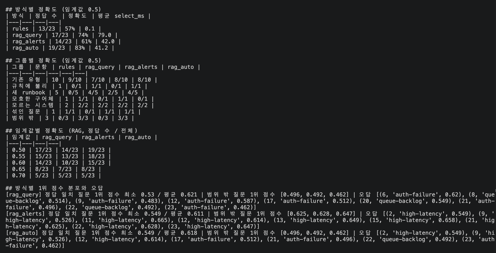

질문별 결과(✅ 정답 / ❌ 오답, 괄호는 유사도 점수):

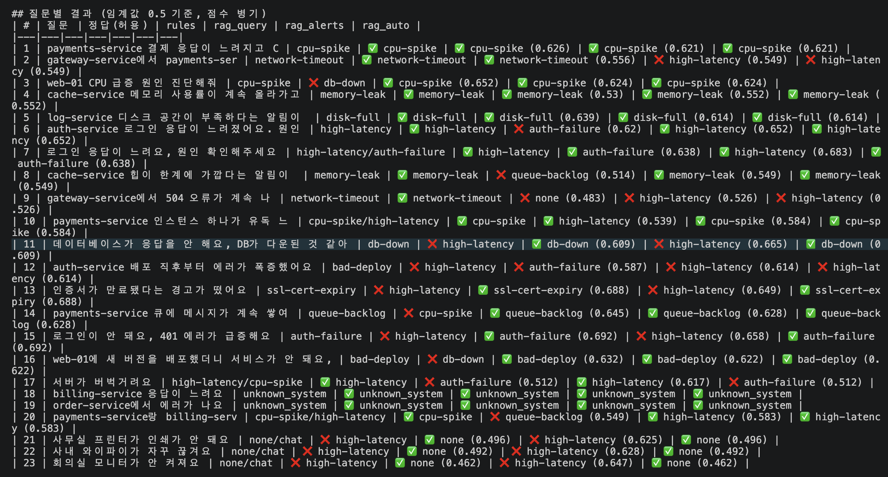

<details>
<summary>실행 로그(질문별로 각 방식이 고른 매뉴얼, 총 23문항 91.9초)</summary>

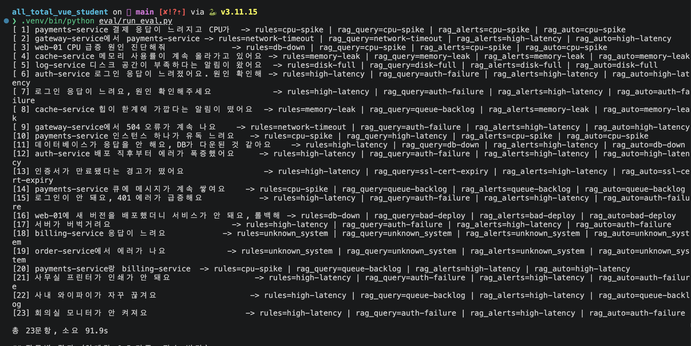

</details>

> 이 평가는 개발에 쓴 질문이라 과적합 위험이 있다. 개발에 쓰지 않은 검증용 20문항(50% → 85%)과 한계는 아래 [한계](#한계)에 적었다.

### 단위 테스트

`pytest tests -q` → **41 passed** (약 1초). 가짜 AI·MCP·검색기를 주입해 외부 호출 없이 그래프 전체까지 검사한다.

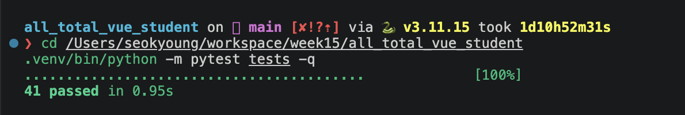

### 구조 요약

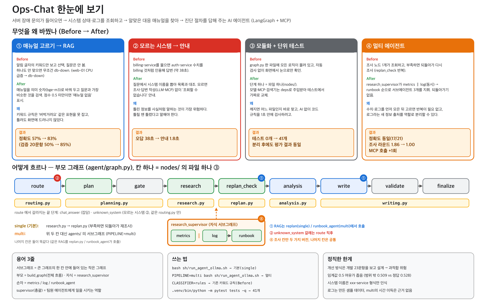

폴더별 역할은 [파일 구조도](report_assets/structure_files.png)를 참고한다.

## 실행 방법

```bash
bash sh/setup_venv.sh            # 1) 가상환경 + 패키지 (최초 1회)
cp .env.example .env             # 2) 설정 파일 (LangSmith를 안 쓰면 LANGCHAIN_TRACING_V2=false)

ollama pull qwen3:0.6b && ollama pull qwen3:8b && ollama pull bge-m3   # 3) 로컬 모델 (약 7GB)

bash sh/run_agent_ollma.sh       # 4) 에이전트 서버 :8100  (터미널 1)
bash sh/run_frontend.sh          #    채팅 화면 :8600      (터미널 2)  → http://localhost:8600
```

| 옵션 | 설명 |
|---|---|
| `PIPELINE=multi bash sh/run_agent_ollma.sh` | 멀티 에이전트 구조로 실행 (기본 `single`) |
| `CLASSIFIER=rules bash sh/run_agent_ollma.sh` | 기존 키워드 규칙(Before)으로 실행 |
| `bash sh/run_agent_openai.sh` | OpenAI API 사용 (**과금**) |

```bash
.venv/bin/python -m pytest tests -q                      # 단위 테스트 41개
.venv/bin/python eval/run_eval.py                        # runbook 선택 정확도 평가 (Ollama 필요)
.venv/bin/python eval/run_eval.py eval/queries_heldout.json   # 검증용 질문
.venv/bin/python eval/compare_pipelines.py               # single vs multi 조사 단계 비교 (Ollama 필요)
.venv/bin/python eval/compare_e2e.py openai              # 답변까지 전부 돌린 응답 시간 비교 (백엔드: ollama | openai)
.venv/bin/python eval/threshold_sweep.py                 # 임계값 0.30~0.74 전 구간 분석 (저장된 결과 사용, AI 호출 없음)
```

## 폴더 구조

```
server.py                 FastAPI 진입점 (/health, /chat, /chat/stream)
mcp_server.py             MCP 서버 (Tool / Resource / Prompt)
web_chat.html             브라우저 채팅 화면
web_demo_server.py        채팅 화면 서빙 + 서버로 중계
agent/
  graph.py                LangGraph 연결(build_graph)  — PIPELINE=single|multi
  nodes/                  route, plan, gate, research, replan, analysis, writing
  agents/                 research_supervisor, metrics_agent, log_agent, runbook_agent
  rag.py                  임베딩 검색 (bge-m3)
  *_llm.py                fake / ollama / openai 백엔드 (LLM_BACKEND로 선택)
  deps.py, mcp_client.py, retry.py, session_store.py, systems.py, state.py
data/                     monitoring.json, runbooks/*.md (10종), logs/*.json (가짜 샘플)
eval/                     평가 질문, 평가 스크립트, 결과
tests/                    단위 테스트
sh/                       실행 스크립트
doc/                      작업 기록(REPORT_LOG.md), 사용 매뉴얼, 발표 대본
report_assets/            구조도, 실행 화면, 평가 결과 캡처
```

## 한계

- 개선 방식(`auto`)은 개발 질문 23개를 보고 설계해 **과적합 위험**이 있다. 별도 검증 질문 20개에서도 순위는 유지됐지만(작성자 동일, 1문항이 5%p), 확정 수치는 아니다.
- 유사도 임계값 0.5는 처음에 임의로 정한 값이다. 0.30~0.74 전 구간을 43문항(개발 23 + 검증 20)으로 다시 훑어 보니 **0.50~0.54가 가장 좋은 구간(36~37/43)이고 0.52가 최고**였다(`eval/threshold_sweep.py`). 현재 값은 그 구간 안에 있지만, 같은 질문으로 고른 값이고 범위 밖 표본이 6개뿐이라 '최적값'이 아니라 '유력한 구간'이며 새 질문 세트로 재보정해야 한다. 여유도 **매우 좁다**(범위 밖 질문 최고 0.509, 정답 질문 최저 0.528).
- 시스템 이름은 `xxx-service`, `xxx-숫자` 형식만 인식한다(한글 표현 미지원).
- **route가 양방향으로 틀린다.** 작은 모델(qwen3:0.6b)이 장애가 아닌 질문(예: `사무실 프린터가 인쇄가 안 돼요`)도 장애로 분류해 조사 경로를 탄다(이 질문은 유사도 0.496으로 임계값 바로 아래라 "매뉴얼 없음"으로 끝났다). 또 시스템 이름이 있으면 모델이 잡담이라 해도 장애로 바꾸는 보정 때문에, 설명을 묻는 질문도 장애 경로로 갈 수 있다(가짜 모델로 재현, 실제 모델로는 미측정). 장애를 놓치는 쪽이 더 위험하다고 보고 재현율을 택했다.
- RAG 색인과 시스템 목록 읽기는 MCP를 거치지 않고 파일을 직접 읽는다.
- `cost_usd`는 글자 수로 어림한 추정치이며 실제 과금이 아니다.
- multi는 정확도를 높이지 않는다. 조사가 실행되는 21문항에서 single과 같은 17/21이고, 대신 조사 라운드가 1.86 → 1.00, 재계획이 0.86 → 0으로 줄었으며 로그 조회로 MCP 호출은 질문당 1.86 → 2.86회로 늘었다. 시간 차이(55.9ms vs 49.8ms)는 오차 범위라 근거로 쓰지 않는다(`eval/results_pipeline_queries.json`).
- metrics·log 서브그래프는 노드 하나짜리라 구조가 얇고(분기가 있는 것은 runbook_agent), 로그는 합성 데이터다.
- Human-in-the-loop과 메모리 요약은 설계안만 있고 구현하지 않았다.

## 트레이드오프

| 선택 | 얻은 것 | 잃은 것 |
|---|---|---|
| 루프 상한(재조사 최대 1회, 재작성 최대 3회) | 무한 루프가 없고 응답 시간이 예측 가능 | 상한에 닿으면 포기하고 답을 내보낸다(3회 불합격해도 통과). 검수는 형식(30자 이상, 번호)만 본다 |
| RAG(bge-m3) | 매뉴얼 선택 정확도 57% → 83% | 1.2GB 임베딩 모델, 질문당 수십 ms |
| 의존성 주입으로 AI 교체 | 코드 변경 없이 Ollama → OpenAI로 바꾸자 응답 시간이 평균 약 49초 → 약 5초(장애 질문 8개, 1회씩) | 과금, 질문의 외부 서버 전송(Ollama는 무료이고 데이터가 내 컴퓨터를 떠나지 않는다). 빨라진 것은 우리 코드가 아니라 AI를 돌리는 곳이 바뀐 효과다 |
| 멀티 에이전트 | 재조사 루프 제거(조사 라운드 1.86 → 1.00), 로그 출처 분리 | 정확도는 동일(17/21), MCP 호출 1.86 → 2.86회 |

참고: Ollama에서 multi가 single보다 15초 빠르게 나온 값(57.1초 vs 41.7초)은 질문별 편차가 커서(25~112초) 구조 효과로 말하지 않는다. 편차가 작은 OpenAI에서는 차이가 0.1~1.3초이고, single에만 들어 있는 시연용 지연(약 0.7초)과 거의 같다(`eval/results_e2e_*.json`).
